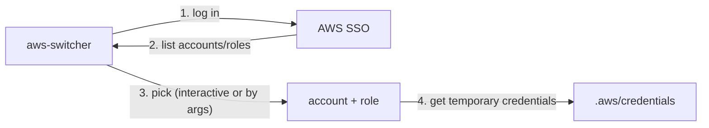

# account-switcher

A command-line tool to simplify switching between AWS accounts and roles via AWS SSO.
It logs in through AWS SSO, lets you pick an account/role, and writes temporary
credentials to the `default` profile in `~/.aws/credentials`.

The tool is implemented in Go and lives in [`go_switcher/`](go_switcher/) —
see [`go_switcher/README.md`](go_switcher/README.md) for installation, usage,
and development details.

> Earlier Python scripts (`switcher_config.py`, `switcher_sso.py`) have been
> replaced by the Go implementation and removed.

## Quick start

```bash
cd go_switcher
make build

# First-time setup: fetch available accounts/roles from SSO
./bin/aws-switcher --start-url https://my-sso-portal.awsapps.com/start/ --update

# Interactive selection
./bin/aws-switcher

# Direct (non-interactive) switch, e.g. for automation
./bin/aws-switcher 058264159440 psc-read-only-secret-perm-set
```



## License

See [LICENSE](LICENSE).
